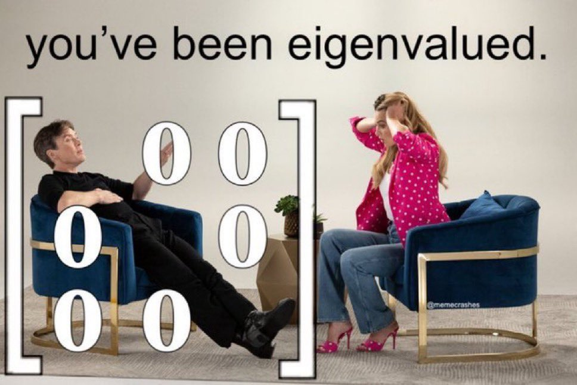

<p align="center">
  
</p>

# Skills para o meu setup


Catálogo das skills de agente que já uso neste Mac e das que entram no mesmo pacote: interface, marca, browser, segurança e o mapa open source. Cada bloco diz para que serve e como instalar.

[](https://nodejs.org/)
[](https://www.python.org/)
[](https://agentskills.io/)
[](https://skills.sh/)

## Pré-requisitos

- Node.js 22 ou mais novo. O Taste Skill precisa dessa versão para os scripts de checagem no browser.
- npm, para o `npx skills`.
- Python 3, para a busca do UI/UX Pro Max e as ferramentas do Logo Design.
- Git.
- Um agente que leia `SKILL.md`: Claude Code, Cursor, Codex, Grok ou outro compatível com [Agent Skills](https://agentskills.io/).
- Google Chrome, Edge ou Chromium, para o Taste Skill e para o `agent-browser`.

Confira o que já está na máquina:

```bash
node -v
python3 --version
npx skills --help
```

## Configuração

A maior parte instala com o [Skills CLI](https://github.com/vercel-labs/skills). `--global` deixa a skill disponível em todos os projetos. `-y` pula a confirmação.

```bash
npx skills add <owner/repo> --skill <nome> --global -y
```

Para ver o que um repositório oferece antes de instalar:

```bash
npx skills add <owner/repo> --list
```

Reinicie o agente depois de instalar. Skill nova só entra na sessão seguinte.

## O que cada um faz

### Já neste Mac

| Skill | Para que serve |
| --- | --- |
| [superpowers](https://github.com/obra/superpowers) | Metodologia do agente: esclarece o pedido, escreve o plano, implementa com testes e revisa antes de encerrar. A skill `using-superpowers` já está em `~/.agents/skills` e `~/.claude/skills`. |
| [security-audit](https://github.com/cloudflare/security-audit-skill) | Auditoria de código em fases, com achados verificáveis. Já está em `~/.agents/skills/security-audit`. |
| [ui-ux-pro-max](https://github.com/nextlevelbuilder/ui-ux-pro-max-skill) | Banco local de estilos, paletas, fontes e regras de UI para web e mobile. Já está em `~/.agents/skills/ui-ux-pro-max`. |

### Método de trabalho

**superpowers** faz o agente parar antes de codar. O fluxo é brainstorming, plano em tarefas pequenas, TDD, review e fechamento do branch. As skills internas incluem `brainstorming`, `writing-plans`, `test-driven-development`, `systematic-debugging` e `subagent-driven-development`.

No Grok:

```bash
grok plugin install superpowers@xai-official --trust
```

**security-audit** conduz uma auditoria defensiva do repositório: reconhecimento, caça por cobertura, validação de cada candidato, `findings.json` e relatório. O modo completo só roda quando a auditoria é pedida. Perguntas pontuais ficam em modo de orientação.

```bash
npx skills add https://github.com/cloudflare/security-audit-skill --skill security-audit --global -y
```

### Interface, marca e página

**ui-ux-pro-max** escolhe estilo, cor, tipo e stack antes de gerar a tela. Cobre React, Next.js, Vue, Tailwind, shadcn/ui, SwiftUI, Flutter e outras. A busca roda em Python no seu computador.

```bash
npx ui-ux-pro-max-cli init --ai claude
```

Troque `claude` por `cursor`, `codex` ou `universal` conforme o agente. `--global` instala na pasta do usuário.

**taste-skill** (`design-taste-frontend`) monta site de empresa com uma direção visual, foto real, uma seção por tela e uma checagem no Chrome antes de entregar. O efeito WebGL fica restrito a página de software, tech e game.

```bash
npx skills add https://github.com/Leonxlnx/taste-skill --skill design-taste-frontend --global -y
```

**web-interface-guidelines** é a lista de decisões de interface da Vercel: teclado, foco, formulário, movimento, performance e texto. O repositório é o guia. A skill que revisa o código contra essas regras é `web-design-guidelines`.

```bash
npx skills add https://github.com/vercel-labs/agent-skills --skill web-design-guidelines --global -y
```

O guia para colar no projeto está em [AGENTS.md](https://raw.githubusercontent.com/vercel-labs/web-interface-guidelines/main/AGENTS.md).

**logo-design** conduz um logo do briefing ao SVG: tipo de marca, construção, cor, teste em tamanho pequeno e uma biblioteca de referência para estudar, sem copiar. As ferramentas são Python, sem dependência extra.

```bash
git clone https://github.com/kaankiziltug/logo-design-skill.git
cp -r logo-design-skill/skills/logo-design ~/.agents/skills/logo-design
```

No Claude Code o caminho oficial é o marketplace: `/plugin marketplace add kaankiziltug/logo-design-skill` e `/plugin install logo-design@logo-design-skill`.

**ip-as-logo** gera mascote simples, com poucas formas, duas cores de personagem e um fundo sólido. O fluxo propõe três direções e, depois do ok, seis imagens. Precisa de um modelo de imagem forte. O resultado é imagem, não SVG.

```bash
npx skills@latest add s1dashu/ip-as-logo-skill --global -y
```

**open-bot-avatar** é uma spec JSON e um renderizador de avatar para agente: um path SVG, a posição dos olhos e humores `idle`, `thinking` e `happy`. A skill `generate-avatar` pede o JSON ao modelo. O pacote na aplicação é separado.

```bash
pnpm add open-bot-avatar
npx skills add DominikScholz/open-bot-avatar --skill generate-avatar --global -y
```

Editor: [dominikscholz.github.io/open-bot-avatar](https://dominikscholz.github.io/open-bot-avatar/).

### Browser

**agent-browser** é o CLI em Rust que abre página, lê a árvore de acessibilidade e clica, preenche e tira screenshot por comando. A skill instalada é um atalho: o guia real vem do próprio CLI, para bater com a versão instalada.

```bash
npm i -g agent-browser
agent-browser install
npx skills add vercel-labs/agent-browser --global -y
```

Antes do primeiro uso no agente: `agent-browser skills get core`.

**remote-agent-browser** é o par do `agent-browser` na nuvem. Sobe o mesmo browser dentro de um Vercel Sandbox, com página, cookie e referências de elemento compartilhados na sessão. Entra como biblioteca no projeto, não como skill.

```bash
pnpm add remote-agent-browser
```

Na Vercel a autenticação usa `VERCEL_OIDC_TOKEN`. Fora dela, o cliente recebe credencial curta de time e projeto. O sandbox pode gerar custo.

### Mapa

**mapcn** é biblioteca de componentes, não uma skill. São mapas React em cima de MapLibre, Tailwind e shadcn/ui: tema claro e escuro, marcador, popup, rota e controles. O projeto também publica uma skill opcional que ensina o agente a usar esses componentes.

Pré-requisito do componente: projeto com Tailwind e shadcn/ui.

```bash
npx shadcn@latest add @mapcn/map
npx skills add AnmolSaini16/mapcn --skill mapcn --global -y
```

Uso mínimo:

```tsx
import { Map, MapControls } from "@/components/ui/map";

export function MyMap() {
  return (
    <Map center={[-46.6333, -23.5505]} zoom={11}>
      <MapControls />
    </Map>
  );
}
```

O mapa padrão usa tiles CARTO. Docs: [mapcn.dev](https://mapcn.dev).

### Front-end e desenvolvimento que valem no pacote

Estas já estão neste Mac e cobrem página, SEO, dados e vídeo em React.

| Skill | Para que serve | Onde está |
| --- | --- | --- |
| `cro` | Revisa landing page e formulário pelo que trava a conversão. | `~/.agents/skills/cro` |
| `seo-audit` | Auditoria técnica: indexação, meta, Core Web Vitals e rastreio. | `~/.agents/skills/seo-audit` |
| `find-skills` | Procura skill pronta no [skills.sh](https://skills.sh/) antes de inventar fluxo novo. | `~/.agents/skills/find-skills` |
| `supabase` | Auth, banco, RLS, Storage, Edge Functions e logs do projeto Supabase. | `~/.agents/skills/supabase` |
| `supabase-postgres-best-practices` | Tipo de coluna, índice, policy e SQL em qualquer Postgres. | `~/.agents/skills/supabase-postgres-best-practices` |
| `remotion-best-practices` | Roteador das skills de vídeo em React: criar, legendar, animar mapa e exportar. | `~/.agents/skills/remotion-best-practices` |
| `threejs-frame-conventions` | Alinha controle, câmera e frente do personagem num Three.js y-up. | skill bundled do Grok |

Duas skills de front-end que ainda não estão instaladas e fecham o pacote com a Vercel:

```bash
npx skills add https://github.com/vercel-labs/agent-skills --skill react-best-practices --global -y
npx skills add https://github.com/vercel-labs/agent-skills --skill composition-patterns --global -y
```

`react-best-practices` junta regras de performance de React e Next.js: waterfall, bundle, render e data fetching. `composition-patterns` cobre composição de componentes em vez de prop drilling e booleanos demais.

## Executando

Instale o que ainda falta neste Mac:

```bash
npx skills add https://github.com/Leonxlnx/taste-skill --skill design-taste-frontend --global -y
npx skills add https://github.com/vercel-labs/agent-skills --skill web-design-guidelines --global -y
npx skills add https://github.com/vercel-labs/agent-skills --skill react-best-practices --global -y
npx skills@latest add s1dashu/ip-as-logo-skill --global -y
npx skills add DominikScholz/open-bot-avatar --skill generate-avatar --global -y
npx skills add vercel-labs/agent-browser --global -y
npx skills add AnmolSaini16/mapcn --skill mapcn --global -y
```

O Logo Design, o pacote `open-bot-avatar`, o `agent-browser` CLI e o `mapcn` no app seguem os comandos das seções acima. Eles não passam só pelo `npx skills`.

Peça ao agente em linguagem normal. Exemplos:

```text
Revise esta landing com ui-ux-pro-max e taste-skill.
Gere um mascote com ip-as-logo para este produto.
Abra o preview local com agent-browser e confira o formulário.
Adicione um mapa do mapcn na página de unidades.
```

> [!WARNING]
> `security-audit` descreve correção no código. Não use para testar sistema, conta ou rede de outra pessoa. `remote-agent-browser` e qualquer sandbox na Vercel podem gerar custo.

## Comandos para entendimento

| Comando | Descrição |
| --- | --- |
| `npx skills add <repo> --list` | Lista as skills de um repositório sem instalar. |
| `npx skills add <repo> --skill <nome> --global -y` | Instala uma skill para todos os projetos. |
| `npx skills update` | Atualiza as skills instaladas pelo CLI. |
| `npx ui-ux-pro-max-cli init --ai claude` | Instala o UI/UX Pro Max no agente escolhido. |
| `npm i -g agent-browser && agent-browser install` | Instala o CLI e o Chrome que ele dirige. |
| `agent-browser skills get core` | Carrega o guia da versão instalada do browser. |
| `npx shadcn@latest add @mapcn/map` | Copia o componente de mapa para o projeto. |
| `pnpm add open-bot-avatar` | Adiciona o renderizador de avatar ao app. |
| `pnpm add remote-agent-browser` | Adiciona o browser de agente na nuvem. |

## Referências

| Peça | Repositório | Papel |
| --- | --- | --- |
| superpowers | [obra/superpowers](https://github.com/obra/superpowers) | Skill |
| security-audit | [cloudflare/security-audit-skill](https://github.com/cloudflare/security-audit-skill) | Skill |
| ui-ux-pro-max | [nextlevelbuilder/ui-ux-pro-max-skill](https://github.com/nextlevelbuilder/ui-ux-pro-max-skill) | Skill |
| taste-skill | [Leonxlnx/taste-skill](https://github.com/Leonxlnx/taste-skill) | Skill |
| web-interface-guidelines | [vercel-labs/web-interface-guidelines](https://github.com/vercel-labs/web-interface-guidelines) | Guia |
| web-design-guidelines | [vercel-labs/agent-skills](https://github.com/vercel-labs/agent-skills) | Skill que aplica o guia |
| logo-design | [kaankiziltug/logo-design-skill](https://github.com/kaankiziltug/logo-design-skill) | Skill |
| ip-as-logo | [s1dashu/ip-as-logo-skill](https://github.com/s1dashu/ip-as-logo-skill) | Skill |
| open-bot-avatar | [DominikScholz/open-bot-avatar](https://github.com/DominikScholz/open-bot-avatar) | Biblioteca e skill |
| agent-browser | [vercel-labs/agent-browser](https://github.com/vercel-labs/agent-browser) | CLI e skill |
| remote-agent-browser | [vercel-labs/remote-agent-browser](https://github.com/vercel-labs/remote-agent-browser) | Biblioteca |
| mapcn | [AnmolSaini16/mapcn](https://github.com/AnmolSaini16/mapcn) | Biblioteca, com skill opcional |
| react-best-practices | [vercel-labs/agent-skills](https://github.com/vercel-labs/agent-skills) | Skill |
| composition-patterns | [vercel-labs/agent-skills](https://github.com/vercel-labs/agent-skills) | Skill |
